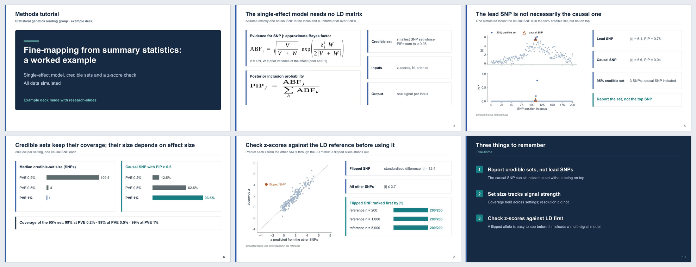

# research-slides

**A Claude Code skill for research presentations: journal clubs and progress talks as
clean, editable PowerPoint decks.**

Give it a paper (or your own results) and ask for a journal-club deck. You get a `.pptx`
with a consistent academic layout, native PowerPoint equations you can still edit,
figures with their sources, every number traced to its source in the speaker notes, and
backup slides hidden at the end. When you later polish the deck by hand in PowerPoint,
the skill revises *your* file instead of overwriting it.



<sub>Slides from the [fine-mapping demo](examples/finemap-demo/): every figure and number comes from the included simulation.</sub>

## Why

General-purpose slide generators produce decks that look like marketing: huge titles,
an icon on every slide, a summary banner at the bottom, and paragraphs in 10 pt type.
The defaults here come from measuring what researchers actually keep after editing a
draft by hand:

| On visible slides | First drafts | After hand editing |
|---|---|---|
| Words per slide (median) | 193 | 112–116 |
| Characters set below 14 pt | 86% | 17–29% |
| Bottom summary bands | on most slides | removed (moved to notes) |
| Secondary results | on main slides | moved to hidden backup slides |
| Titles | rhetorical | plain and descriptive |

## Features

- **Two deck architectures**: journal club (problem → key idea → pipeline → worked example
  → simulations → results → limitations → take-home) and research progress (sectioned,
  figure-led).
- **A pptxgenjs theme** (`theme.js`): cover, content, section divider with a progress
  tracker, take-home slide, cards, process flows aligned to columns, stat callouts,
  native bar comparisons, label-and-line rows, figure placement by aspect ratio, and
  slide-number fields that survive reordering.
- **Native, editable equations** (OMML), with the LibreOffice round-trip traps handled.
- **Reproducible build**: pptxgenjs → equations → LibreOffice re-save (so PowerPoint never
  asks to "repair" the file) → hidden-slide guard → density audit.
- **QA tools**: per-slide word and small-type audit calibrated on hand-edited decks;
  rendering to a labelled contact sheet; a fresh-eyes visual review procedure.
- **Safe revision of hand-edited decks**: detects files saved by PowerPoint, never
  overwrites them, writes `_v2`, and shows what was changed by hand (`diff_decks.py`).
- **Claim discipline for journal clubs**: numbers verified against the paper, hedges
  kept, paper-internal inconsistencies recorded on a backup slide.

## Examples

| Example | What it shows | Files |
|---|---|---|
| [Fine-mapping demo](examples/finemap-demo/) | A 10-slide methods tutorial (+2 hidden) on fine-mapping from summary statistics, fully simulated: drawn and generated figures, native equations, numbers read straight from the simulation's `results.json`, notes on every slide that needs one | [`.pptx`](examples/finemap-demo/finemap-demo.pptx) · [build script](examples/finemap-demo/build_deck.js) · [simulation](examples/finemap-demo/simulate.py) |
| [Synthetic demo](examples/synthetic-demo/) | Every building block once, as a progress-talk skeleton with section dividers | [`.pptx`](examples/synthetic-demo/synthetic-demo.pptx) · [build script](examples/synthetic-demo/build_deck.js) |


## Install

### As a Claude Code plugin

```bash
claude plugin marketplace add Chen-Po/research-slides-skill
claude plugin install research-slides@research-slides-skill
```

Inside a Claude Code session you can use `/plugin marketplace add Chen-Po/research-slides-skill`
and then `/plugin install research-slides@research-slides-skill` instead. To update later:
`claude plugin marketplace update research-slides-skill`.

### Manually

```bash
git clone https://github.com/Chen-Po/research-slides-skill.git
cp -R research-slides-skill/plugins/research-slides/skills/research-slides ~/.claude/skills/
```

### Requirements

| Tool | Used for |
|---|---|
| Node.js ≥ 18 and `pptxgenjs` 4.x (`npm install -g pptxgenjs`) | building decks |
| Python ≥ 3.9 (standard library; `Pillow` for contact sheets) | equations, audits, guards |
| LibreOffice | the re-save step and rendering for QA |
| poppler (`pdftoppm`) | rendering slides to images |
| Anthropic's `pptx` skill (optional) | editing an existing .pptx in place |

Tools are found on `PATH` (LibreOffice also in its standard macOS locations); override with
`NODE`, `PYTHON`, `SOFFICE` or `PDFTOPPM`.

## Use

Just ask Claude Code, for example:

> Make a journal club deck on `paper.pdf` for Thursday's lab meeting, about 12 slides,
> with the supplement as backup slides.

> I edited `JC_2026.pptx` in PowerPoint. Shorten slides 5–7 and add a backup slide with
> the runtime table.

> Build a progress-report deck from the figures in `results/`, three sections: background,
> method, results.

The skill plans the slide list first, verifies numbers against the source, builds, audits
density, renders a contact sheet and runs a visual review before handing the deck over.

To run an example yourself:

```bash
cd examples/finemap-demo
python simulate.py        # numpy, scipy, matplotlib; about a minute
RESEARCH_SLIDES=../../plugins/research-slides/skills/research-slides/scripts bash build.sh
```

## Design defaults

White ground, Arial, 24 pt navy titles, a thin blue stripe on the left edge, 14–16 pt body
text, white cards with a coloured left edge, at most ~120 words per slide, the takeaway in
the speaker notes rather than on the slide, and backup slides hidden after the closing
slide. All of it lives in [`theme.js`](plugins/research-slides/skills/research-slides/scripts/theme.js)
and [`references/style.md`](plugins/research-slides/skills/research-slides/references/style.md);
change the tokens to make it yours.

## Repository layout

```
.claude-plugin/marketplace.json        plugin marketplace entry
plugins/research-slides/
  .claude-plugin/plugin.json
  skills/research-slides/
    SKILL.md                           what the agent follows
    references/                        style, deck types, build pipeline, traps, QA
    scripts/                           theme.js, omml_lib.py, deck_metrics.py, render.sh, ...
    assets/build.sh.template           the 5-step build
examples/                              two complete decks with their build scripts
docs/images/                           README images
```

## Limitations

- Visual QA renders through LibreOffice, which differs slightly from PowerPoint in font
  metrics and equation rendering. Open the final deck in PowerPoint before presenting.
- Tested on macOS. Linux should work with LibreOffice and poppler on `PATH` but has not
  been tested; Windows has not been tested.
- Editing an existing deck in place relies on Anthropic's `pptx` skill, which is not
  bundled here.
- The style is deliberately opinionated. It suits lab meetings and seminars; it is not a
  template for conference keynotes or posters.

## License

[MIT](LICENSE). The example decks use only simulated data and figures generated by the
included scripts.

## Contributing

Issues and pull requests are welcome, especially new deck architectures, theme variants,
and traps you hit with pptxgenjs, OMML or LibreOffice. Please include a rendered contact
sheet (`scripts/render.sh`) with visual changes.
