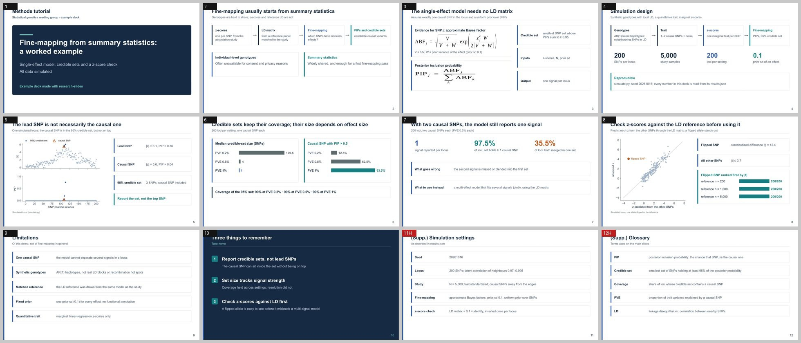

# Example: fine-mapping demo

A 10-slide methods tutorial (plus 2 hidden backup slides) on fine-mapping from summary
statistics, built entirely from simulated data:

- a single-effect model with approximate Bayes factors, PIPs and 95% credible sets;
- a worked locus where the lead SNP is not the causal one;
- calibration and resolution across effect sizes (200 loci per setting);
- what happens with two causal SNPs;
- a z-score consistency check that flags an allele flipped in the LD reference.

**Download:** [`finemap-demo.pptx`](finemap-demo.pptx)



## Reproduce

```bash
python simulate.py     # writes results.json and figs/*.png (numpy, scipy, matplotlib; about a minute)
RESEARCH_SLIDES=../../plugins/research-slides/skills/research-slides/scripts bash build.sh
```

`build_deck.js` reads every number from `results.json`, so the deck always matches the
simulation that produced it. Change the seed or the settings at the top of `simulate.py`
and rebuild.

The simulation is a teaching example, not a benchmark: genotypes come from a simple
latent AR(1) model, the LD reference is drawn from the same model as the study, and the
fine-mapping model allows one causal SNP per locus. The deck's Limitations slide says so.
