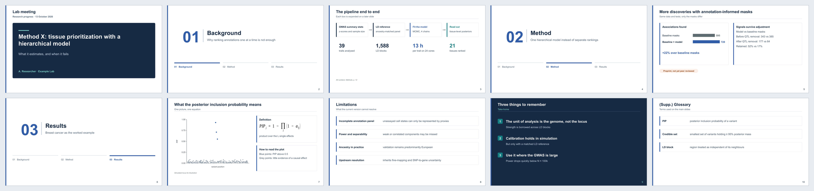

# Example: synthetic demo

Every `theme.js` building block once, on placeholder content, shaped like a research
progress talk: cover, three section dividers with a tracker, a process flow with stats
aligned to its columns, native bar comparison, figure + equation, limitations rows, a
take-home slide and a hidden backup slide.

**Download:** [`synthetic-demo.pptx`](synthetic-demo.pptx)



```bash
RESEARCH_SLIDES=../../plugins/research-slides/skills/research-slides/scripts bash build.sh
```

`placeholder.png` is generated by `make_placeholder.py` (simulated data).
